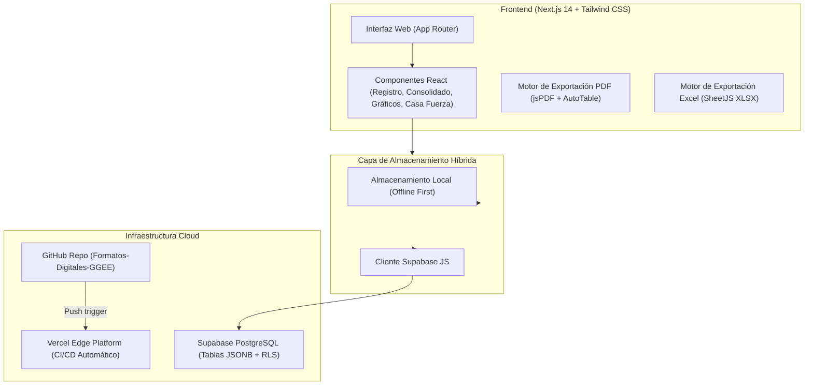

# Guía Integral de Desarrollo y Despliegue — Formatos Digitales GGEE Copeinca

## 1. Resumen Ejecutivo del Proyecto
El sistema **Formatos Digitales GGEE** digitaliza y moderniza los formatos operativos en planta de **Copeinca (Sede Bayóvar)**, reemplazando el registro manual en hojas Excel (`GPP-FOR-021 Registro de Operaciones de Grupos Electrógenos v01.xlsx` y `Formato de casa de fuerza..xls`) por una plataforma web progresiva, moderna, reactiva y de alto rendimiento.

El diseño sigue estrictamente la línea gráfica corporativa de Copeinca (`plant-vision-copeinca`), con navegación compacta, widgets táctiles, paleta de colores teal oscuro (`#0b424c`), exportación fiel a PDF oficial con logotipos de alta definición, y arquitectura preparada para operar tanto de forma local offline como sincronizada en la nube con **Supabase** y **Vercel**.

---

## 2. Arquitectura Tecnológica



### Stack Técnico:
* **Framework Principal:** [Next.js 14.2.15](https://nextjs.org/) (App Router, soporte SSR/CSR).
* **Lenguaje:** TypeScript 5.6 (tipado estricto para confiabilidad operacional).
* **Estilos:** Tailwind CSS 3.4 (con paleta oficial Copeinca `#0b424c`, `#152336`, `#f3f6f9`).
* **Iconografía:** Lucide React.
* **Base de Datos & Backend:** PostgreSQL en [Supabase](https://supabase.com/) con políticas de seguridad RLS.
* **Hosting & CI/CD:** [Vercel](https://vercel.com/) conectado al repositorio GitHub.
* **Reportes:** `jspdf`, `jspdf-autotable` y `xlsx`.

---

## 3. Catálogo Oficial de Grupos Electrógenos

El sistema opera con los **9 grupos electrógenos oficiales** de planta (excluyendo el Grupo 2 según requerimiento de planta):

| ID | Nombre Oficial | Motor / Modelo | Parámetros Clave de Medición |
|---|---|---|---|
| **G1** | `GRUPO 1 - BURMEISTER` | Burmeister | Presión Aceite (PSI), T° Agua (°C), RPM, Frecuencia (Hz), Amperaje (A), Cos φ, Energía (kWh) |
| **G3** | `GRUPO 3 - BURMEISTER` | Burmeister | Presión Aceite (PSI), T° Agua (°C), RPM, Frecuencia (Hz), Amperaje (A), Cos φ, Energía (kWh) |
| **G4** | `GRUPO 4 - KTA 19` | Cummins KTA 19 | Presión Aceite (PSI), T° Agua (°C), RPM, Frecuencia (Hz), Amperaje (A), Cos φ, Energía (kWh) |
| **G5** | `GRUPO 5 - CAT C18` | Caterpillar C18 | Presión Aceite (PSI), T° Agua (°C), RPM, Frecuencia (Hz), Amperaje (A), Cos φ, Energía (kWh) |
| **G6** | `GRUPO 6 - KTA 50` | Cummins KTA 50 | Presión Aceite (PSI), T° Agua (°C), RPM, Frecuencia (Hz), Amperaje (A), Cos φ, Energía (kWh) |
| **G7** | `GRUPO 7 - CAT 3306` | Caterpillar 3306 | Presión Aceite (PSI), T° Agua (°C), RPM, Frecuencia (Hz), Amperaje (A), Cos φ, Energía (kWh) |
| **G9** | `GRUPO 9 - PERKINS` | Perkins | Presión Aceite (PSI), T° Agua (°C), RPM, Frecuencia (Hz), Amperaje (A), Cos φ, Energía (kWh) |
| **G10** | `GRUPO 10 - CAT 3512 (PIS)`| Caterpillar 3512 PIS | Presión Aceite (PSI), T° Agua (°C), RPM, Frecuencia (Hz), Amperaje (A), Cos φ, Energía (kWh) |
| **G11** | `GRUPO 11 - CAT 3512 B` | Caterpillar 3512 B | Presión Aceite (PSI), T° Agua (°C), RPM, Frecuencia (Hz), Amperaje (A), Cos φ, Energía (kWh) |

---

## 4. Módulos Desarrollados y Funcionalidades

### 4.1. Encabezado Corporativo y Selector de Área
* **Componente:** `src/components/HeaderCopeinca.tsx`
* **Características:**
  * Logo de Copeinca recortado con fondo transparente y tamaño destacado.
  * Selector de Área: Alterna dinámicamente entre **GGEE (Grupos Electrógenos)** y **Casa de Fuerza**.
  * Indicador de estado de sincronización (Nube / Local) en tiempo real.

### 4.2. Barra de Herramientas y Control de Turno
* **Componente:** `src/components/ToolbarCopeinca.tsx`
* **Características:**
  * Selector de fecha con botones rápidos de anterior, siguiente y "Hoy".
  * Navegación por pestañas: **Registro por Hora**, **Hoja Consolidada** y **Gráficos por Hora**.
  * Botón **"Guardar Registro"** (estilo Copeinca `#0b424c`).
  * Botón **"Descargar PDF"** oficial.

### 4.3. Pestaña 1: Registro por Hora
* **Componente:** `src/components/RegistroPorHoraTab.tsx`
* **Características:**
  * **Turno y Operadores:** Selección visual de Turno A (07:00 - 19:00) o Turno B (19:00 - 07:00), con nombres editables de los operadores de guardia.
  * **Selector de 24 Horas:** Matriz interactiva de horas (01:00 a 00:00). La hora seleccionada se resalta con fondo verde oscuro (`#0b424c`). Incluye indicador de lecturas completadas (`X/24`).
  * **Selección de Grupos en Operación:** Botones táctiles para cada uno de los 9 grupos. Al hacer clic se activan o desactivan para la hora en curso.
  * **Tarjetas Compactas de Medición:** Tarjetas con cabecera oscura (`#152336`), insignia *Operando*, e inputs centrados de tipo pill con unidades integradas (`PSI`, `°C`, `RPM`, `HZ`, `A`, `COS Φ`, `KWH`).
  * **Función Copiar Hora Anterior:** Permite duplicar las mediciones de la hora previa para agilizar el llenado.
  * **Guardado 100% Manual:** Solo se persiste la información cuando el operador presiona voluntariamente **"Guardar Registro"**, mostrando una notificación de confirmación con check verde.

### 4.4. Pestaña 2: Hoja Consolidada
* **Componente:** `src/components/HojaConsolidadaTab.tsx`
* **Características:**
  * Matriz tabular de doble nivel de cabecera que lista las 24 horas y todos los parámetros de los 9 grupos.
  * Botón de **Exportación Oficial a PDF** con estructura idéntica al formato físico de Copeinca: logo corporativo, metadatos, datos tabulares y cuadros de firma de VoBo de Jefatura y Superintendencia.
  * Botón de **Exportación a Excel (.xlsx)** para auditoría y procesamiento de datos.

### 4.5. Pestaña 3: Gráficos por Hora
* **Componente:** `src/components/GraficosPorHoraTab.tsx`
* **Características:**
  * Tarjetas de KPI en tiempo real: Valor Promedio, Valor Máximo, Valor Mínimo y Total de Puntos Registrados.
  * Selector de variable operativa (Temperatura, Presión de Aceite, Velocidad, Frecuencia, Amperaje, Cos φ, Energía).
  * Filtro por grupos electrógenos con colores diferenciados.
  * Gráficas SVG multi-línea con curvas horarias y bandas de rango óptimo de operación.

### 4.6. Módulo de Casa de Fuerza
* **Componente:** `src/components/CasaFuerzaForm.tsx`
* **Características:**
  * Registro de los 15 equipos auxiliares de Casa de Fuerza (Compresores Atlas Copco / Kaeser, Bombas de Agua, Bombas de Petróleo, Separadoras Alfa Laval / Westfalia).
  * Control de Horómetro Inicial, Horómetro Final y cálculo automático de Horas Trabajadas.

---

## 5. Estructura de Archivos del Proyecto

```
FORMATOS DIGITALES GGEE/
├── app/
│   ├── globals.css              # Estilos globales y Tailwind directives
│   ├── layout.tsx               # Root layout HTML/Head
│   └── page.tsx                 # Entrypoint con carga dinámica client-side
├── public/
│   ├── copeinca-logo.png        # Logo oficial transparente de alta resolución
│   └── favicon.ico
├── src/
│   ├── components/
│   │   ├── HeaderCopeinca.tsx   # Header corporativo y selector de área
│   │   ├── ToolbarCopeinca.tsx  # Barra de fecha, tabs y acciones
│   │   ├── RegistroPorHoraTab.tsx # Formulario táctil compacto de los 9 grupos
│   │   ├── HojaConsolidadaTab.tsx # Matriz 24h y botones de exportación
│   │   ├── GraficosPorHoraTab.tsx # Gráficas SVG y analítica horaria
│   │   └── CasaFuerzaForm.tsx   # Registro de 15 equipos de casa de fuerza
│   ├── services/
│   │   ├── storage.ts           # Gestión híbrida LocalStorage + Supabase
│   │   ├── supabase.ts          # Inicializador cliente Supabase
│   │   ├── pdfExport.ts         # Generador de PDF oficial Copeinca
│   │   └── excelExport.ts       # Generador de libro Excel .xlsx
│   ├── types/
│   │   └── index.ts             # Tipos TypeScript y catálogo GRUPOS_OFICIALES
│   └── App.tsx                  # Componente contenedor principal y estado
├── supabase/
│   └── schema.sql               # Script SQL DDL con tablas, triggers y RLS
├── .env.example                 # Plantilla de variables de entorno
├── INICIAR_SISTEMA_LOCAL.bat    # Lanzador automático para desarrollo local
├── SUBIR_A_GITHUB.bat           # Script de despliegue a GitHub
├── next.config.mjs              # Configuración Next.js
├── tailwind.config.js           # Tema y colores Copeinca
└── tsconfig.json                # Configuración de compilador TypeScript
```

---

## 6. Configuración de Base de Datos (Supabase)

El script SQL completo se encuentra en `supabase/schema.sql`.

### Tablas Principales:
1. `gpp_registros_dia`:
   * Clave primaria: `fecha` (un registro por día operativo).
   * Almacena: Operadores Turno A/B, observaciones, firmas de VoBo, matriz `grupos_activos_por_hora` (JSONB) y estado de lecturas de los 9 grupos `grupos` (JSONB).
2. `casa_fuerza_registros_dia`:
   * Clave primaria: `fecha`.
   * Almacena: Operadores, estado de los 15 equipos y horómetros en estructura JSONB.

### Pasos para aplicar en Supabase:
1. Ingresar a tu proyecto en [supabase.com](https://supabase.com/).
2. Ir a la sección **SQL Editor**.
3. Abrir el archivo `supabase/schema.sql`, copiar todo su contenido y pegarlo en el editor.
4. Presionar el botón **Run**.
5. Las tablas, índices de fecha, triggers de actualización automática y políticas de lectura/escritura pública quedarán configuradas.

---

## 7. Configuración de Variables de Entorno

### Archivo `.env.local` (Desarrollo Local):
```env
NEXT_PUBLIC_SUPABASE_URL=https://TU_PROYECTO.supabase.co
NEXT_PUBLIC_SUPABASE_ANON_KEY=TU_LLAVE_ANON_PUBLICA
```

### En Vercel:
1. Entra a tu proyecto en **Vercel** (`Settings` -> `Environment Variables`).
2. Agrega las siguientes variables:
   * **Nombre:** `NEXT_PUBLIC_SUPABASE_URL` | **Valor:** La URL de tu proyecto en Supabase.
   * **Nombre:** `NEXT_PUBLIC_SUPABASE_ANON_KEY` | **Valor:** La anon/public API key de tu proyecto.
3. Guarda los cambios.

> [!NOTE]
> Si no configuras las variables de Supabase de inmediato, el sistema funciona de manera autónoma guardando todos los datos en el `localStorage` del navegador sin generar ningún error ni interrumpir la operación de planta.

---

## 8. Flujo de Despliegue en Vercel y GitHub

El repositorio está vinculado en:
**`https://github.com/mantenimientobayovar-dot/Formatos-Digitales-GGEE.git`**

### Pipeline Automatizado:
Cada vez que se hace un `git push` a la rama `main`:
1. Vercel detecta automáticamente el nuevo commit mediante el webhook de GitHub.
2. Descarga el código y ejecuta `npm install`.
3. Ejecuta `next build` realizando verificación de tipos TypeScript y optimización de páginas estáticas.
4. Despliega la aplicación globalmente en su red Edge CDN y genera el enlace de producción HTTPS.

---

## 9. Comandos y Scripts de Mantenimiento Local

* **Iniciar en modo local:**
  Hacer doble clic en `INICIAR_SISTEMA_LOCAL.bat` ubicado en el escritorio. Se abrirá automáticamente en `http://localhost:3000`.
* **Subir cambios a GitHub manualmente:**
  Hacer doble clic en `SUBIR_A_GITHUB.bat` o ejecutar en terminal:
  ```powershell
  git add .
  git commit -m "feat: actualizacion de formato"
  git push origin main
  ```
* **Probar compilación de producción en local:**
  ```powershell
  npm run build
  ```
